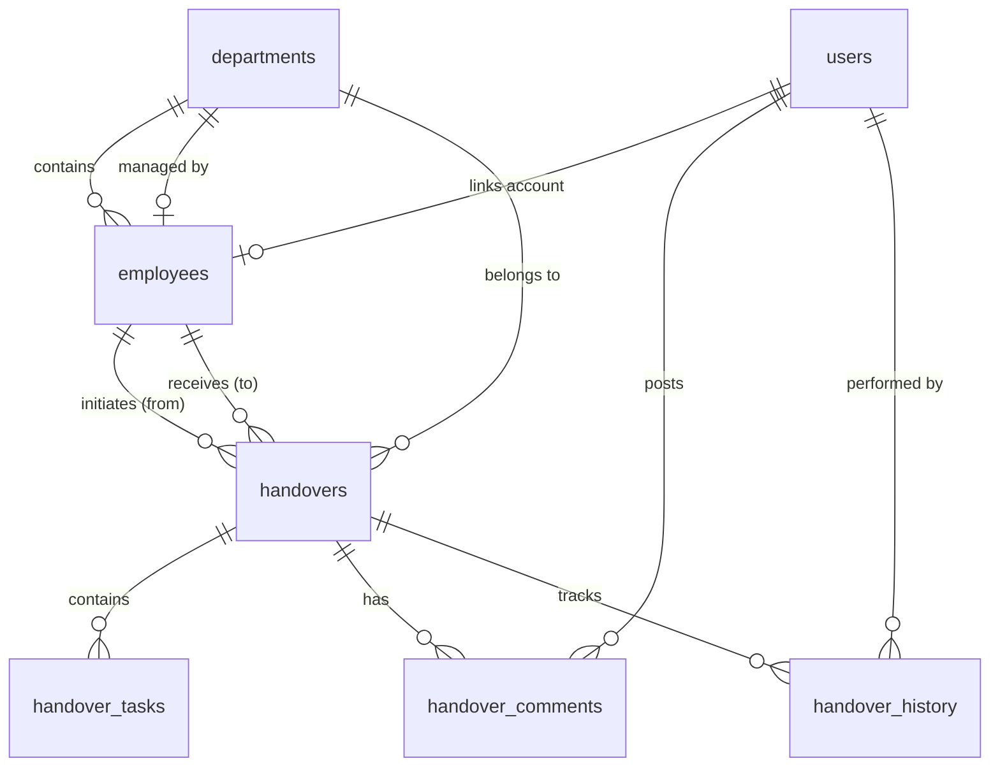

# Database Design & Architecture

## System: Employee Responsibility Handover & Transition Management System
**Database Name**: `employee_handover`  
**Engine**: `InnoDB`  
**Character Set**: `utf8mb4`  
**Collation**: `utf8mb4_unicode_ci`

---

## 1. Entity-Relationship Overview

---

## 2. Table Data Dictionaries

### 2.1 Table: `users`
Stores login credentials and role assignment for simple academic authentication.

| Field | Type | Nullable | Key | Default | Description |
| :--- | :--- | :--- | :--- | :--- | :--- |
| `id` | BIGINT | NO | PK | Auto-inc | Primary key |
| `username` | VARCHAR(50) | NO | UK | None | Unique login username |
| `email` | VARCHAR(100) | NO | UK | None | Unique email address |
| `password` | VARCHAR(100) | NO | None | None | Plaintext credentials for academic demo |
| `role` | ENUM('ADMIN', 'MANAGER', 'EMPLOYEE') | NO | None | None | System authorization level |
| `created_at` | TIMESTAMP | YES | None | CURRENT_TIMESTAMP | Account creation timestamp |

### 2.2 Table: `departments`
Stores organizational business divisions.

| Field | Type | Nullable | Key | Default | Description |
| :--- | :--- | :--- | :--- | :--- | :--- |
| `id` | BIGINT | NO | PK | Auto-inc | Primary key |
| `department_name` | VARCHAR(100) | NO | UK | None | Unique department title |
| `description` | TEXT | YES | None | NULL | Department mission/scope |
| `manager_employee_id` | BIGINT | YES | FK | NULL | Foreign key referencing `employees.id` (department manager) |
| `created_at` | TIMESTAMP | YES | None | CURRENT_TIMESTAMP | Record timestamp |

### 2.3 Table: `employees`
Staff profiles containing contact info, designation, and links to user credentials.

| Field | Type | Nullable | Key | Default | Description |
| :--- | :--- | :--- | :--- | :--- | :--- |
| `id` | BIGINT | NO | PK | Auto-inc | Primary key |
| `employee_code` | VARCHAR(20) | NO | UK | None | Corporate staff identifier (e.g. `EMP-101`) |
| `first_name` | VARCHAR(50) | NO | None | None | First name |
| `last_name` | VARCHAR(50) | NO | None | None | Last name |
| `email` | VARCHAR(100) | NO | UK | None | Corporate email address |
| `phone` | VARCHAR(20) | YES | None | NULL | Telephone contact number |
| `designation` | VARCHAR(100) | NO | None | None | Role title (e.g. Senior Lead Engineer) |
| `department_id` | BIGINT | NO | FK | None | FK referencing `departments.id` |
| `joining_date` | DATE | NO | None | None | Employment start date |
| `employment_status`| ENUM | NO | None | 'ACTIVE' | `ACTIVE`, `ON_NOTICE`, `TRANSFERRED`, `RESIGNED`, `ON_LEAVE` |
| `user_id` | BIGINT | YES | UK, FK | NULL | FK referencing `users.id` (allows user account link) |
| `created_at` | TIMESTAMP | YES | None | CURRENT_TIMESTAMP | Record timestamp |

### 2.4 Table: `handovers`
Central transition record representing the transfer of duties.

| Field | Type | Nullable | Key | Default | Description |
| :--- | :--- | :--- | :--- | :--- | :--- |
| `id` | BIGINT | NO | PK | Auto-inc | Primary key |
| `handover_code` | VARCHAR(30) | NO | UK | None | Formatted transition tracking code (e.g. `HO-2026-001`) |
| `from_employee_id` | BIGINT | NO | FK | None | Outgoing employee (`employees.id`) |
| `to_employee_id` | BIGINT | NO | FK | None | Designated successor (`employees.id`) |
| `department_id` | BIGINT | NO | FK | None | Department context (`departments.id`) |
| `reason` | ENUM | NO | None | None | `RESIGNATION`, `DEPARTMENT_TRANSFER`, `EXTENDED_LEAVE`, `ROLE_CHANGE`, `OTHER` |
| `description` | TEXT | NO | None | None | Core transition scope |
| `additional_notes` | TEXT | YES | None | NULL | Special instructions, emergency escalation contacts |
| `last_working_date`| DATE | NO | None | None | Departure milestone deadline |
| `status` | ENUM | NO | None | 'DRAFT' | `DRAFT`, `PENDING_MANAGER`, `PENDING_RECEIVER`, `CLARIFICATION_REQUESTED`, `REJECTED_BY_MANAGER`, `COMPLETED` |
| `created_at` | TIMESTAMP | YES | None | CURRENT_TIMESTAMP | Submission timestamp |
| `updated_at` | TIMESTAMP | YES | None | CURRENT_TIMESTAMP | Update timestamp |

### 2.5 Table: `handover_tasks`
Checklist of responsibilities, credentials, and assets transferred.

| Field | Type | Nullable | Key | Default | Description |
| :--- | :--- | :--- | :--- | :--- | :--- |
| `id` | BIGINT | NO | PK | Auto-inc | Primary key |
| `handover_id` | BIGINT | NO | FK | None | FK referencing `handovers.id` (CASCADE DELETE) |
| `title` | VARCHAR(200) | NO | None | None | Actionable task headline |
| `description` | TEXT | YES | None | NULL | Walkthrough or verification steps |
| `priority` | ENUM | NO | None | 'MEDIUM' | `LOW`, `MEDIUM`, `HIGH` |
| `due_date` | DATE | NO | None | None | Target completion date |
| `task_status` | ENUM | NO | None | 'PENDING' | `PENDING`, `IN_PROGRESS`, `COMPLETED` |
| `notes` | TEXT | YES | None | NULL | Additional documentation or vault link |
| `created_at` | TIMESTAMP | YES | None | CURRENT_TIMESTAMP | Created timestamp |

### 2.6 Table: `handover_comments`
Clarification dialogues between outgoing staff, receiving successors, and managers.

| Field | Type | Nullable | Key | Default | Description |
| :--- | :--- | :--- | :--- | :--- | :--- |
| `id` | BIGINT | NO | PK | Auto-inc | Primary key |
| `handover_id` | BIGINT | NO | FK | None | FK referencing `handovers.id` (CASCADE DELETE) |
| `user_id` | BIGINT | NO | FK | None | FK referencing `users.id` |
| `comment` | TEXT | NO | None | None | Comment body |
| `created_at` | TIMESTAMP | YES | None | CURRENT_TIMESTAMP | Posted timestamp |

### 2.7 Table: `handover_history`
Audit ledger tracking workflow milestone events.

| Field | Type | Nullable | Key | Default | Description |
| :--- | :--- | :--- | :--- | :--- | :--- |
| `id` | BIGINT | NO | PK | Auto-inc | Primary key |
| `handover_id` | BIGINT | NO | FK | None | FK referencing `handovers.id` (CASCADE DELETE) |
| `action` | VARCHAR(60) | NO | None | None | Event name (e.g. `Manager Approved`) |
| `description` | TEXT | NO | None | None | Detailed audit event message |
| `performed_by` | BIGINT | NO | FK | None | FK referencing `users.id` |
| `created_at` | TIMESTAMP | YES | None | CURRENT_TIMESTAMP | Event timestamp |
